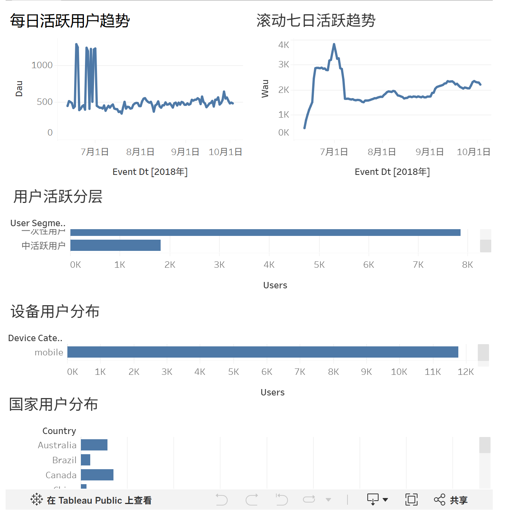
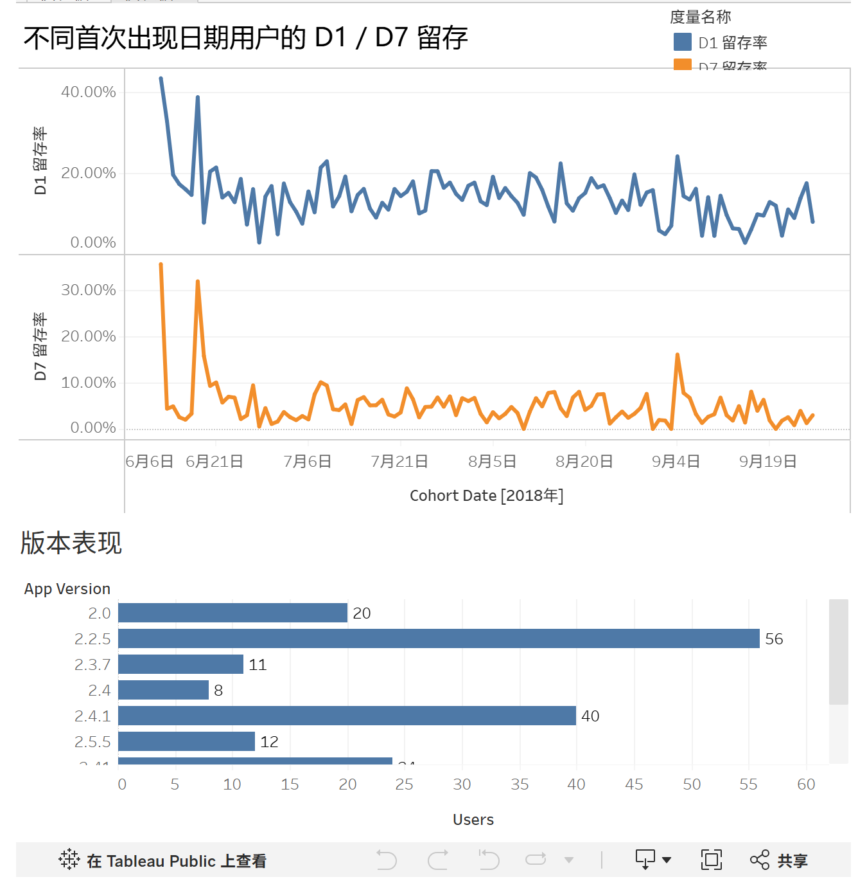

# 游戏 APP 用户活跃与留存分析

**工具：** BigQuery SQL、Tableau  
**项目时间：** 2025.08–2025.10

## 分析目标

分析游戏用户活跃、留存和关键行为转化，识别新用户进入核心玩法及关卡后虚拟货币消费的优化机会。

## 数据与方法

使用 Google Firebase 公开游戏事件表 `firebase-public-project.analytics_153293282.events_*`。已提供[SQL 查询](sql/README.md)和[八份汇总结果及口径说明](data/README.md)。当前汇总数据日期范围为 2018-06-12 至 2018-10-03，与项目开展时间不同。

- 清洗与聚合事件数据，计算 DAU、WAU、D1/D7 留存等指标。
- 统计首次启动、开始关卡、完成关卡和虚拟货币消费等事件的覆盖人数；当前 SQL 尚未限制事件顺序，严格时序漏斗待完善。
- 按 Cohort 和活跃频次分析留存与用户行为差异。

## 结果与交付

具体数值待代码复核后补充。分析建议聚焦新用户关卡引导、关卡后消费触点和用户分层运营，未将建议表述为已验证的业务提升。

## Tableau 可视化

[打开 Tableau Public 交互工作簿](https://public.tableau.com/views/_17925091618830/2?:showVizHome=no) · [可视化说明](tableau/README.md)

### 用户活跃概览

展示每日活跃、滚动七日活跃、用户活跃分层、设备与国家分布。

### 留存与版本表现

展示按首次出现日期划分的 D1/D7 留存及版本用户规模。

截图为用户提供的当前页面预览，部分图表包含滚动区域；完整内容请打开交互工作簿。两张截图共用已提供的工作簿入口，可在网页仪表板选项卡切换。

## 复核与复现材料

- 数据来源、分析日期与时区。
- 新用户定义、留存观察窗口及观察期不足的样本处理方式。
- 漏斗用户范围、去重规则、事件顺序与转化窗口。
- 用户分层定义及对应 SQL。
- 虚拟货币消费不等同于真实付费。
- SQL 执行顺序、汇总 CSV 和 Tableau 工作簿。
