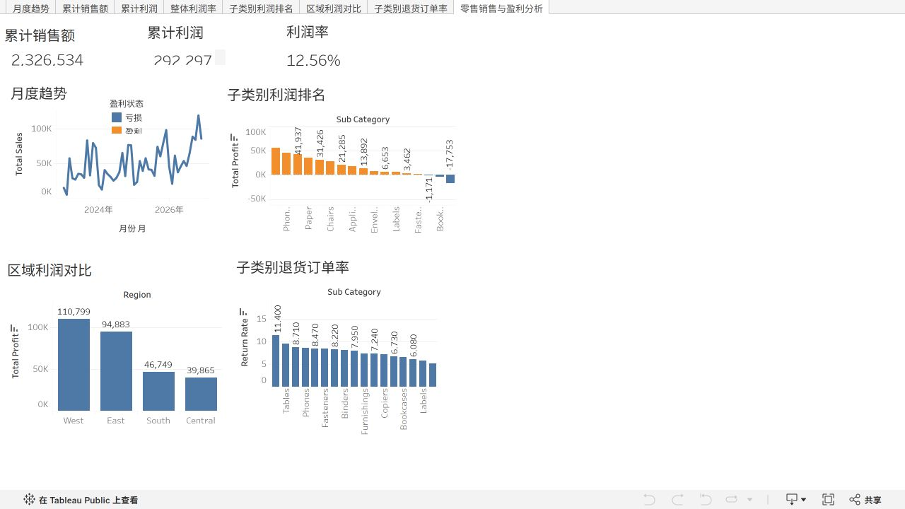

# 零售企业销售与利润分析

**工具：** MySQL、Python、Tableau  
**项目时间：** 2025.12–2026.02

## 分析目标

分析销售与利润结构，定位亏损品类、折扣相关的利润差异和区域退货差异。

## 数据与方法

已提供 [11 份 MySQL SQL](sql/README.md)和[6 份查询汇总 CSV](data/README.md)。代码涉及订单、退货及区域负责人等表；公开数据来源链接、原始数据和字段字典尚未提供。

- 构建销售额、利润率、客单价及退货率等经营指标。
- 按地区、品类和折扣水平下钻，分析 Tables 品类亏损情况。
- 项目原描述还包含 Python 折扣分析和区域退货分析；相应代码或结果尚未提交，暂不作为已复核结果。

## 结果与交付

以下数字根据仓库内已上传的 CSV 摘录或汇总，未重新连接 MySQL 执行查询；展示性发现不等同于已经验证的运营效果。金额单位与币种尚未提供，因此本节不添加货币符号。

### 1. 整体经营表现与月度趋势

根据 [sales.csv](data/processed/sales.csv) 的 48 个月度汇总行：

| 指标 | 结果 | 计算口径 |
| --- | ---: | --- |
| 累计销售额 | **2,326,534.39** | 月度 `total_sales` 合计 |
| 累计利润 | **292,296.84** | 月度 `total_profit` 合计 |
| 整体利润率 | **12.56%** | 累计利润 ÷ 累计销售额 × 100 |

看板已用月度销售曲线展示各月表现，配合累计销售、利润及利润率指标卡提供经营概览。整体利润率使用总额相除，不使用月度利润率的简单平均。

导出表日期标签为 **2023-01 至 2026-12**。它与项目时间 2025.12–2026.02 不一致，且包含本次整理时尚未发生的月份；日期是否重编码、是否为示例标签需核实。本节只描述现有文件，不将标签认定为已经发生的真实交易时间。

金额按已四舍五入的汇总值计算。不同粒度导出表的销售合计存在 **0.04**、利润合计存在 **0.01** 的小额差异，未回到原始明细确认原因；本节总体指标统一使用月度表，不混用不同表的总额。

### 2. 商品子类别盈利表现

根据 [sub_category.csv](data/processed/sub_category.csv)，17 个子类别中，以下 3 类汇总利润为负：

| 子类别 | 销售额 | 利润 | 利润率 |
| --- | ---: | ---: | ---: |
| Tables | 208,020.18 | **-17,753.21** | -8.53% |
| Bookcases | 115,361.20 | -3,632.07 | -3.15% |
| Supplies | 46,725.50 | -1,171.39 | -2.51% |

Tables 是当前子类别表中亏损金额最大的类别，可作为后续明细排查对象。利润金额前三的子类别为 **Copiers 56,093.94、Phones 45,050.83、Accessories 41,936.64**。看板通过子类别利润排名和盈利／亏损颜色区分展示这些结果。

目前未提供折扣结果 CSV 或 Python 代码，因而不在本节确认“亏损由折扣导致”，也不报告未经复核的相关系数。

### 3. 区域利润对比

根据 [state sales.csv](data/processed/state%20sales.csv)，将州省汇总金额按 `region` 加总：

| 区域 | 销售额 | 利润 | 利润率 |
| --- | ---: | ---: | ---: |
| West | 739,813.62 | **110,798.83** | 14.98% |
| East | 691,828.16 | 94,883.26 | 13.71% |
| South | 391,721.90 | 46,749.45 | 11.93% |
| Central | 503,170.67 | 39,865.30 | 7.92% |

各区域利润率均由本区域总利润除以总销售额复算，不对州省利润率取平均。看板已展示四个区域的利润金额对比；上述差异是汇总结果，不能据此归因于区域负责人或某项运营策略。

### 4. 子类别退货订单率

根据 [sub return.csv](data/processed/sub%20return.csv)，当前表中退货订单率最高的三个子类别为：

| 子类别 | 涉及该子类别的去重订单数 | 退货订单数 | 退货订单率 |
| --- | ---: | ---: | ---: |
| Machines | 114 | 13 | **11.40%** |
| Tables | 314 | 30 | 9.55% |
| Appliances | 459 | 40 | 8.71% |

计算方式为“该子类别关联到退货表的去重订单数 ÷ 该子类别去重订单数 × 100”。一个退货订单可能包含多个子类别，因此这些结果不能相加推算整体退货率；订单关联也不代表该订单中的每件商品都已退货。

目前仅有子类别退货结果，尚未提供整体及区域退货结果表；本节不沿用此前简历中的整体退货率或 West 区域退货率。退货源表是否只包含已退货订单，仍需与 [SQL 说明](sql/README.md)中的标记条件核对。

### 5. 后续排查与验证

- **亏损品类：**围绕 Tables、Bookcases、Supplies 补充订单明细，检查折扣、成本及商品结构，再判断是否需要调整定价和促销。
- **退货品类：**针对 Machines、Tables、Appliances 进一步查看退货原因、区域和订单结构，同时保留样本量信息。
- **区域差异：**在相同品类和折扣范围内比较区域，避免把商品构成差异直接解释为运营能力差异。

以上均为后续验证方向，当前没有策略上线、实验或实施后效果数据，不声称已提升利润或降低退货率。

### 6. 已交付材料

| 交付物 | 内容与入口 |
| --- | --- |
| SQL | [11 份查询及文件索引](sql/README.md)：日期清洗、异常检查、经营概览、趋势、品类、区域、折扣和退货 |
| 查询结果 | [6 份 CSV 及字段说明](data/README.md)：月度销售、环比、季节性、州省销售、子类别盈利及退货 |
| Tableau 看板 | [零售销售与盈利分析](https://public.tableau.com/views/_17925509934870/sheet7?:showVizHome=no) |
| 看板预览 | [当前页面截图](tableau/screenshots/retail_overview.png) |
| 可视化说明 | [指标单位、显示状态及复现边界](tableau/README.md) |

当前尚未提供原始数据、建表导入脚本、Python 分析代码、折扣查询结果和 `.twbx` 工作簿，仓库现有交付物不等同于已可从零完整复现全部项目。

## Tableau 可视化

[打开在线交互看板](https://public.tableau.com/views/_17925509934870/sheet7?:showVizHome=no) · [查看可视化说明](tableau/README.md)

## 复核与复现材料

- 数据来源、币种、交易时间范围与每张表的数据粒度。
- 多表关联键、关联前后行数和重复记录检查。
- 去重订单数与订单明细行数的区别。
- 利润率是否为总利润除以总销售额。
- 退货率的分子、分母及订单去重规则。
- 折扣分组阈值、SQL 执行顺序、Python 环境和 Tableau 汇总数据。
